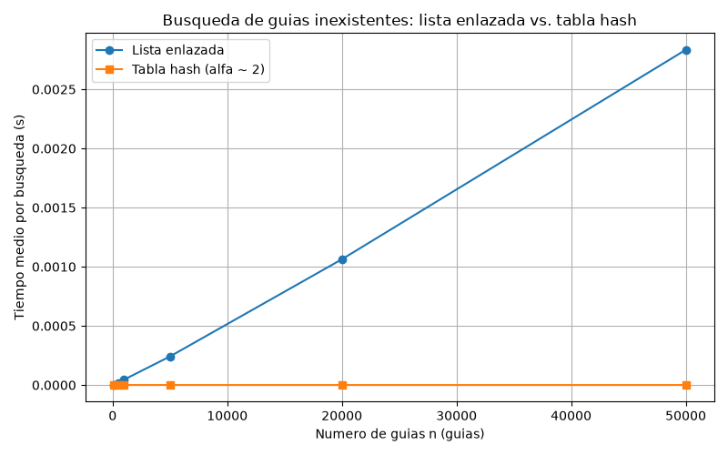
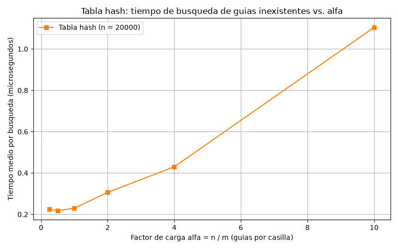

# Laboratorio 3 — Estructuras de datos: lista enlazada vs. tabla hash

Autor: Alvaro de Jesús Sotelo Galvis — Análisis de Algoritmos, ITM.

## Instrucciones de reproducción

1. Crear (solo la primera vez) y activar el entorno virtual desde la raíz del repositorio:
   - Windows: python -m venv venv, luego venv\Scripts\activate
   - macOS / Linux: python3 -m venv venv, luego source venv/bin/activate

2. Instalar las dependencias con pip install -r requirements.txt.

3. Desde esta carpeta (laboratorios/lab3-estructuras-datos/), ejecutar:
   - python pruebas.py, que verifica la lista enlazada y la tabla hash.
   - python medicion.py, que corre los dos experimentos, imprime las tablas de tiempos y genera
     las dos gráficas en graficas/.

---

## Parte 1 — Implementar y verificar las dos estructuras

Código: [estructuras.py](estructuras.py) · [pruebas.py](pruebas.py)

En esta primera parte implementé una lista enlazada en la que cada nodo almacena la guía, su estado y la referencia al siguiente nodo. La inserción se realiza al inicio, haciendo que el nuevo nodo apunte a la cabeza anterior y pase a ser la nueva cabeza, por lo que esta operación tiene una complejidad Θ(1). Para la búsqueda utilicé un ciclo while que recorre los nodos hasta encontrar la guía o llegar al final, retornando None cuando no existe; preferí hacerlo de forma iterativa para evitar problemas con el límite de recursión de Python al manejar una gran cantidad de nodos. También implementé una tabla hash mediante encadenamiento, donde cada posición contiene una lista enlazada y la casilla correspondiente se calcula utilizando el método de división h(k) = k mod m. Tanto al insertar como al buscar, la tabla trabaja únicamente sobre la lista enlazada de la casilla calculada, sin tener que recorrer las demás. Para comprobar el funcionamiento realicé pruebas con búsquedas exitosas y fallidas, estructuras vacías y una colisión forzada con m = 7, donde las guías 10, 24 y 17 quedan en la casilla 3; posteriormente verifiqué que las tres pudieran encontrarse, que dicha casilla tuviera una longitud de 3 y que el factor de carga fuera 3/7. Además, realicé pruebas con 20 colecciones aleatorias usando una semilla fija de 2026, comprobando que para las guías existentes ambas estructuras devolvieran el mismo estado y que para las guías inexistentes ambas devolvieran None. Toda la implementación se realizó sin utilizar dict, set ni la función hash() de Python.

## Parte 2 — Medir y graficar

Código: [medicion.py](medicion.py)

En la segunda parte realicé diferentes mediciones para comparar el rendimiento de la lista enlazada y la tabla hash. Para esto generé guías distintas de 10 dígitos utilizando una semilla fija de 2026, asegurando que ambas estructuras trabajaran con los mismos datos. También generé 200 guías inexistentes utilizando una semilla 7, con el fin de medir el comportamiento de las búsquedas cuando el elemento no se encuentra. En el experimento A trabajé con valores de n de 100, 500, 1.000, 5.000, 20.000 y 50.000, mientras que el tamaño m de la tabla se definió como el número primo más cercano a n/2, manteniendo un factor de carga cercano a 2. Para el experimento B mantuve fijo n = 20.000 y varié el factor de carga con valores de 0,25, 0,5, 1, 2, 4 y 10, calculando m como el primo más cercano a n/α. Los tiempos se midieron con time.perf_counter(), teniendo en cuenta únicamente las búsquedas y dejando por fuera la construcción de las estructuras y la generación de los datos. El tiempo promedio por búsqueda se obtuvo dividiendo el tiempo total entre las 200 búsquedas realizadas. Para disminuir el efecto del ruido en las mediciones, repetí cada prueba 3 veces para la lista enlazada y 51 veces para la tabla hash, tomando como resultado el menor tiempo obtenido. Antes de cada medición también verifiqué con 100 guías existentes que ambas estructuras devolvieran correctamente el estado esperado. Finalmente, los resultados del experimento A se expresaron en segundos y los del experimento B en microsegundos.

### Experimento A — Lista enlazada frente a tabla hash

| n | m | α | Lista (s) | Tabla (s) |
|---|---|---|---|---|
| 100 | 53 | 1.89 | 3.364e-06 | 2.440e-07 |
| 500 | 251 | 1.99 | 1.817e-05 | 2.280e-07 |
| 1000 | 499 | 2.00 | 4.573e-05 | 3.130e-07 |
| 5000 | 2503 | 2.00 | 2.416e-04 | 2.835e-07 |
| 20000 | 10007 | 2.00 | 1.063e-03 | 2.700e-07 |
| 50000 | 24989 | 2.00 | 2.834e-03 | 2.765e-07 |

### Experimento B — Efecto del factor de carga (n = 20000)

| α | m | Tabla (µs) |
|---|---|---|
| 0.25 | 79999 | 0.224 |
| 0.50 | 40009 | 0.217 |
| 1.00 | 19997 | 0.229 |
| 2.00 | 10007 | 0.306 |
| 4.00 | 4999 | 0.430 |
| 10.01 | 1999 | 1.105 |

---

## Parte 3 — Análisis

### 1. Costo teórico

### 2. Lo medido contra lo esperado

### 3. Las colisiones

### 4. Tabla hash o árbol de búsqueda

### 5. Concepto para la jefa de operaciones
